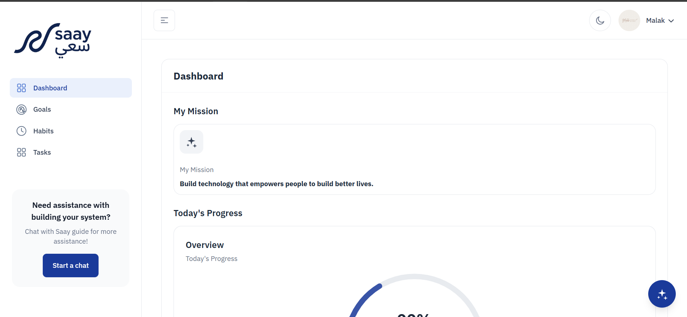
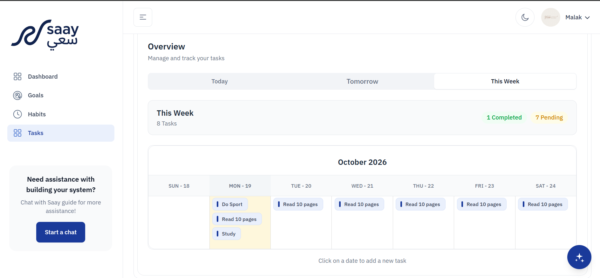
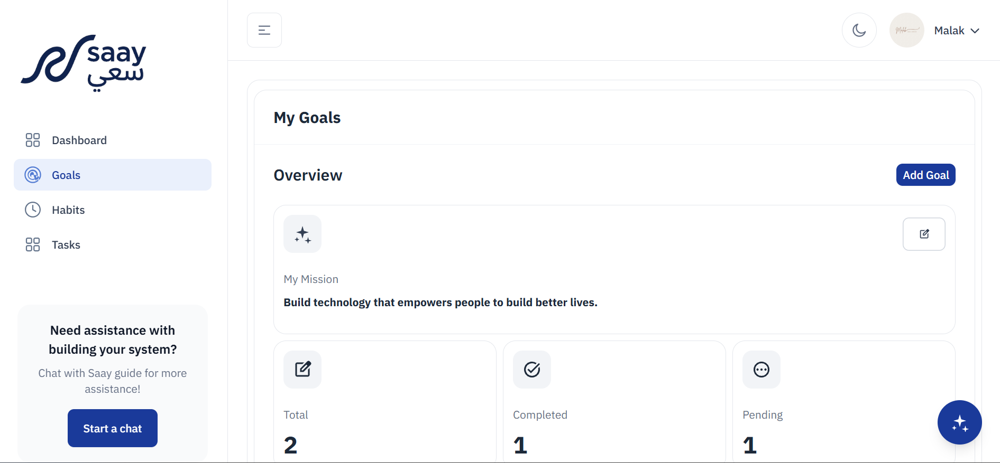
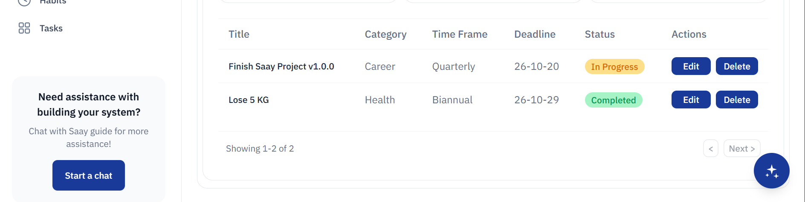
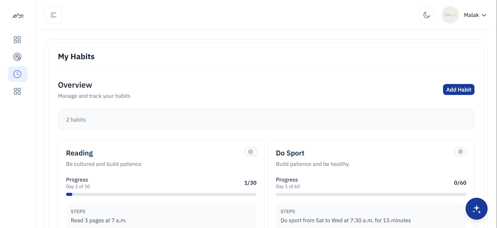
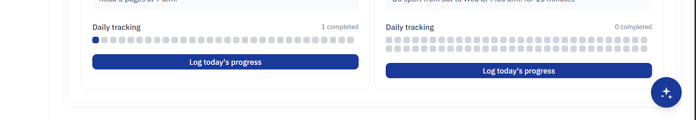
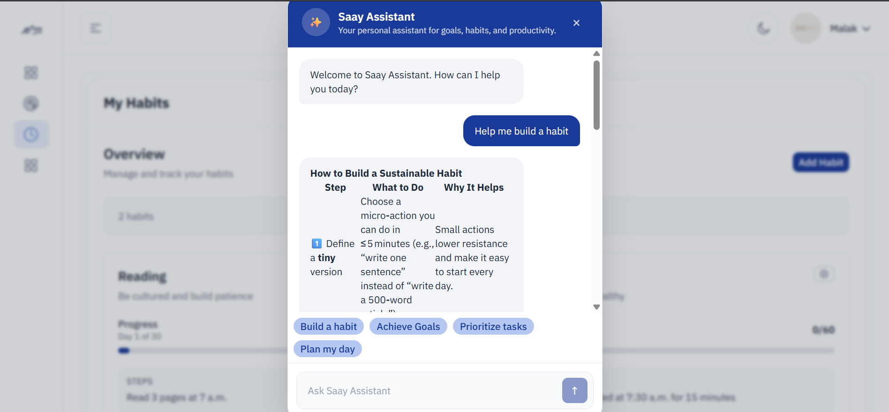
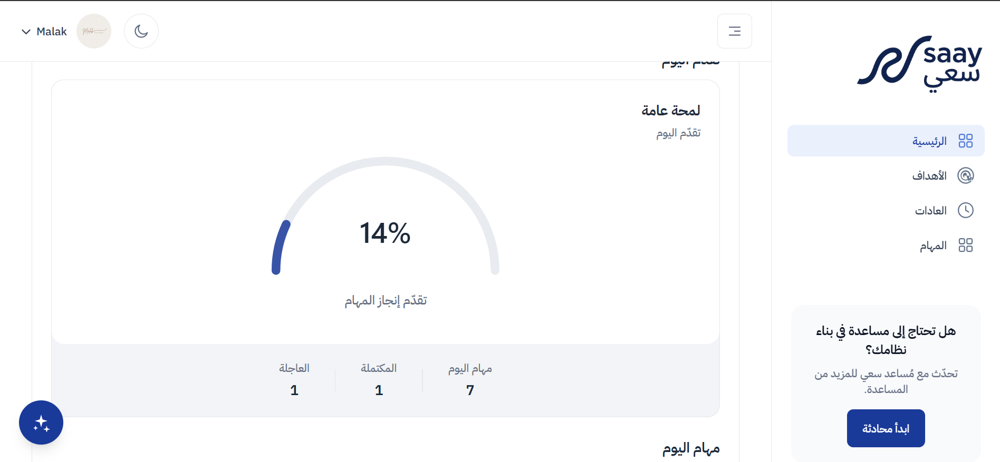
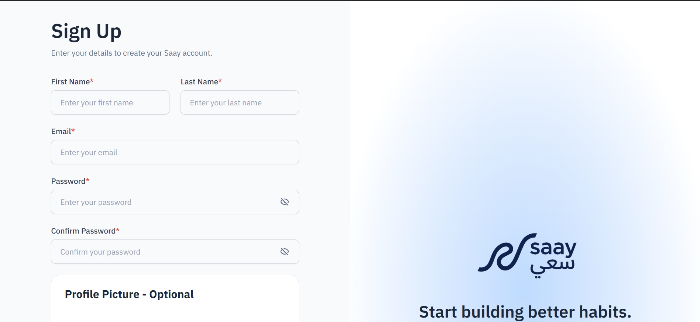
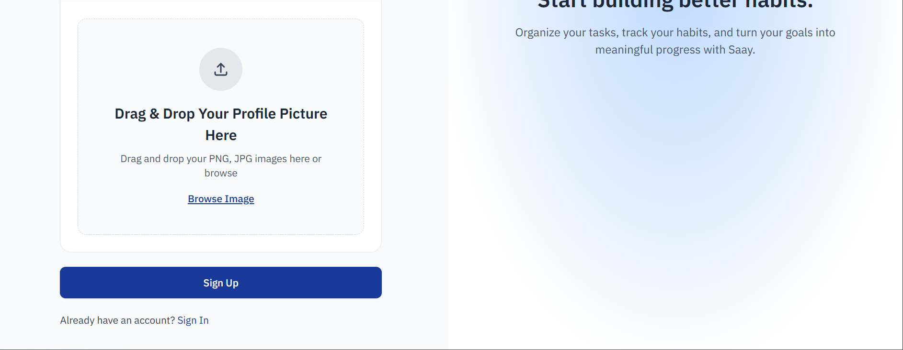

# ☑️ Saay | سعي

Saay is a full-stack productivity website for organizing everyday tasks, setting personal goals, and building lasting habits. It includes an interactive dashboard, account management, and an AI productivity assistant. The frontend is built with React, TypeScript, and React Router; the backend is an ASP.NET Core Web API backed by SQL Server.

## 🚀 Live Demo

Explore Saay directly in your browser:

- Live Application: https://saay.vercel.app
- Backend API: https://saay.runasp.net/swagger/index.html

## ✅ Features

- 👤 Create an account, sign in, confirm an email address, and reset a password.
- ✅ Create, update, delete, and complete tasks; view task lists by date and track progress.
- 🎯 Create and manage goals, including their categories and completion status.
- 🔁 Create habits, set a target duration, and log daily progress.
- 📊 View dashboard summaries and progress for tasks and goals.
- 🗓️ View scheduled items in calendar views.
- 🤖 Ask the built-in AI assistant for practical help with planning, goals, habits, and productivity.
- 🖼️ Add a profile picture and manage account and security settings.
- 🌙 Switch between light and dark themes.
- 🌐 Use English or Arabic, including right-to-left (RTL) layout for Arabic.
- 📱 Use a responsive interface designed for different screen sizes.
- 🔐 Store application records in SQL Server and protect API routes with JWT authentication and ownership checks.

## 🧰 Technologies

### Frontend

- React 19 and TypeScript
- React Router 8
- Vite 8
- Tailwind CSS 4
- i18next and React-i18next
- FullCalendar and ApexCharts
- Browser `localStorage` and `sessionStorage` for client-side preferences and session-related values

### Backend

- C# and ASP.NET Core Web API (.NET 8)
- Entity Framework Core 8 and SQL Server
- JWT bearer authentication and authorization policies
- Swagger / OpenAPI
- Azure Key Vault configuration support (local only)
- MailKit for Gmail SMTP
- Groq API for AI chat
- ImgBB API for profile-picture uploads

## 🏗️ Project Structure

```text
.
├── backend/
│   ├── Saay.API/            # ASP.NET Core API, controllers, Swagger and configuration
│   ├── Saay.Data/           # EF Core context and database entities
│   ├── Saay.Extensions/     # Dependency injection, authentication and API policies
│   ├── Saay.Infrastructure/ # DTOs and validation
│   ├── Saay.Repository/     # Data access interfaces and implementations
│   ├── Saay.Services/       # Application, email, AI and image-storage services
│   └── Saay.slnx            # .NET solution
└── frontend/
    ├── app/
    │   ├── components/      # Shared UI and feature components
    │   ├── context/         # Authentication, language, theme and layout state
    │   ├── routes/          # Landing, account, dashboard and feature routes
    │   └── services/        # API clients and browser-storage helpers
    ├── public/              # Static assets
    └── package.json         # Frontend scripts and dependencies
```

## 🗄️ Data and Integrations

The backend persists users, tasks, task categories, goals, goal categories, habits, habit logs, tokens, and AI conversations through Entity Framework Core and SQL Server.

External services are used for selected capabilities:

- **Azure Key Vault** can provide API configuration and secrets. The development settings include a Key Vault URL; either authenticate to Azure locally or override `KeyVault:Url` with an empty value when using local configuration.
- **Gmail SMTP** sends account confirmation and password-reset messages. Configure `EmailFrom` and `AuthenticationPassword`.
- **Groq** powers AI chat. Configure `Groq_API_KEY` and `Model`.
- **ImgBB** stores uploaded profile pictures. Configure `ImgBB_API_Key`.

## 📸 Screenshots

### Dashboard




### Task Management



### Goal Management




### Habit Management




### AI Chatbot



### Arabic Layout



### Authentication



